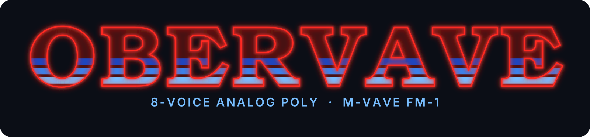
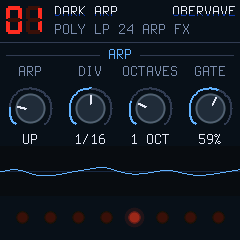

<p align="center"></p>

# OberVave

**One 8-voice analog-style polysynth for the M-VAVE FM-1, with chorus, delay and a plate reverb.**

OberVave turns the FM-1 into a single, deep instrument in the spirit of the classic American 8-voice poly synths of
1979-84: two oscillators a voice with hard sync and cross-modulation, a 12 / 24 dB filter with an SEM-style
lowpass-to-highpass morph, two envelopes, an LFO, an arpeggiator, 32 programs, and three effects after the voices.
No sequencer, no second engine: one synth, as far as the chip goes.

<p align="center"></p>

> **Status: 1.1, host-tested, not yet run on an FM-1.** The engine, the effects, the programs, the panel and the
> screen all run in the host build (the same C on a computer: WAV out, screens as PNG). The device package builds
> (`build/obervave.fwsc`, identity `FM-1_950`). The first install on an FM-1 is the next step; the CPU meter on the
> GLOBAL page will say whether the reverb stays at the full sample rate.

Hear it: [the video](video/) is nine OberVaves (the host build) playing one slow, dark track; every sound in it,
drums included, is this firmware.

## The synth

| | |
| --- | --- |
| **Voices** | 8. POLY (round-robin, steals the oldest released), DUAL (2 detuned voices a note), UNISON (2-8 voices, detune and pan spread), MONO (last note, legato). Glide in every mode. |
| **Oscillators** | 2 a voice: saw, pulse, saw+pulse, off. Pulse width and PWM. OSC 2: ±24 semitones, fine detune, hard sync to OSC 1, filter envelope to pitch (sync sweeps), X-MOD (OSC 2 → OSC 1 linear FM). Noise. PolyBLEP anti-aliasing, free-running phases. |
| **Filter** | State-variable, trapezoidal: LP 12, HP 12, BP 12, notch, LP 24 (two cascaded), SEM (LP → notch → HP by MORPH). Cutoff, resonance with a soft, bounded self-oscillation, envelope amount (bipolar), key tracking, velocity, drive before the filter. |
| **Envelopes** | Filter ADSR and amp ADSR with analog RC curves, 0.5 ms to 10 s. |
| **LFO** | Triangle, saw, ramp, square, S&H, smooth random; 0.05 to 30 Hz; delay / fade-in; phase SYNC / FREE / SPREAD (an offset per voice). To pitch (OSC 1 / 2 / both), PWM, filter, amp. The mod wheel adds vibrato and filter. |
| **Vintage** | Each of the 8 voice cards has its own small tune, cutoff and envelope offsets, plus a slow random walk on pitch, all scaled by one knob. SPREAD pans the cards like the originals' pan pots. |
| **Effects** | Chorus (two taps, Hermite-interpolated). Ping-pong delay in note values of the tempo (1/16 to 1/2, dotted and triplet), with feedback tone; the time slews like a tape when it changes. Plate reverb (Dattorro's figure-of-eight tank) at the full sample rate: SIZE, DAMP, PRE-DLY, MIX. |
| **Arpeggiator** | UP, DOWN, UP/DN, RANDOM, AS PLAYED; 1-4 octaves; 1/4 to 1/32 with triplets; gate; latch (HOLD). Sample-exact, in the audio interrupt. Follows MIDI clock. |
| **Sequencer** | Two tracks that share 256 steps (one track can have them all, or A and B split them). A step is a chord of up to 4 notes with velocity, gate or a tie into the next step, a ratchet (1-4 hits) and a chance. Each track has its own length (polymeters), note value (1/4 to 1/32 with triplets), swing and transpose, and can be muted. Step recording (chords from the keys or MIDI, rests) and live recording into the running loop, quantized to the nearest step. 8 patterns in flash, two factory ones in D Phrygian. Sample-exact in the audio interrupt, follows MIDI clock, start and stop. Both tracks play the one OberVave sound. |
| **Programs** | 32: factory set in flash, your saves in the settings sector. 01 DARK ARP, 26 UPSIDE ARP, 29 NEON PAD are the dark ones; brass, strings, leads, basses, bells, pads, drums-from-a-filter for the rest. Press the SELECT knob twice for a new one at random, within useful ranges. |
| **MIDI** | USB-MIDI in and out. Notes, velocity, pitch bend (range 0-24), program change, sustain, mod wheel, clock / start / continue, MIDI channel or OMNI. CC 74 cutoff, 71 resonance, 73 / 72 amp attack / release, 5 glide, 1 mod depth, 7 volume, 64 sustain, 120 / 123 all off; every other parameter from CC 20 up in the order of the parameter table (see `firmware/src/obv_params.h` and CLAUDE.md). |

Integers only: the chip has no FPU. The whole engine is fixed point, the tables are generated by
`tools/gen_tables.py` and committed.

## The panel

- **PRESETS** picks the program, **ALGORITHM** is always CUTOFF, **SELECT** scrolls the pages, **KNOB 1-4** are the page's
  four parameters. The MASTER knob is the volume.
- **HOME**: PERFORM (resonance, envelope amount, release, mod depth). **EDIT** cycles OSC 1 / OSC 2 / OSC MOD / FILTER /
  FILTER +. **ENV**: FILTER ENV / AMP ENV. **LFO**: LFO / LFO DEST / LFO +. **FX**: CHORUS / DELAY / REVERB.
  **ARP**: the arp page (MODE switches it off); on it, the button is HOLD (latch / sustain). **GLO**: GLOBAL (tempo,
  MIDI channel, tune, CPU meter) / VOICE / OUTPUT. **SEQ**: SEQUENCER (track A / B, length, note value, swing) /
  SEQ + (pattern, transpose, mute, clear: turn it all the way) / STEP (the step at the cursor: step, gate or TIE,
  ratchet, chance).
- **PLAY** starts the sequencer from step 1 and stops it. **REC** records into the track shown: stopped, the keys
  write the chord at the cursor and move on when all are up, **SEQ** writes a rest; running, the notes land on the
  nearest step. The strip under the knobs shows 16 steps: the chords as bars, the playhead blue, the cursor red.
- **SAVE** twice = save the program, or on a sequencer page the pattern (written once the sequencer stops).
  **SELECT** pressed twice = a random sound. **OCT- / OCT+** = octave.
- The key LEDs show the notes that sound, the page buttons light for the page you are on, the eight round LEDs on
  the screen glow with each voice's envelope.

## Build and run

OberVave is built on [Dinghy](https://github.com/zvenson/dinghy), whose platform (boot, USB, updates, audio, settings)
it keeps unchanged; the setup is Dinghy's (Linux x86-64, Python 3 with Pillow, the JieLi toolchain, three files of
the JieLi AC79 SDK: see Dinghy's README, "Set up once").

```sh
tests/run_host.sh                 # the synth on your computer: build/host/obervave.wav and screens as PNG
tests/run_host.sh my-script.txt   # your own keys / buttons / knob turns / MIDI over time (tests/host.c explains)
./build.sh                        # the device package: build/obervave.fwsc
python3 tools/fm1_install.py build/obervave.fwsc   # onto the FM-1 over USB
```

The build refuses what would brick an FM-1 (a 64-bit division, a call into the chip ROM, too much RAM); the rules
are in `docs/RULES.md`, the platform calls in `docs/API.md`.

The video: `video/song.py` writes nine scripts, runs nine host instances filmed at 30 fps and mixes the stems;
`video/make_video.py` cuts the film. Both need only Python, NumPy, Pillow and ffmpeg.

## Credits and licence

GPL-3.0-only, see `LICENSE` and `LICENSING.md` for who made what. OberVave stands on
[Dinghy](https://github.com/zvenson/dinghy) (zvenson), which carries the FM-1 platform of
[Felucca](https://github.com/hugelton/Felucca) by Leo Kuroshita (Hügelton Instruments) with the changes of
[SLOOP](https://github.com/isod89/sloop-fm1) (isod89). The filter follows Andrew Simper's trapezoidal SVF, the reverb
Jon Dattorro's 1997 plate.

OberVave is inspired by the classic 8-voice poly synths of 1979-84 (Oberheim's OB-X and OB-8 era). Those names are
trademarks of their owners; OberVave is not made by or affiliated with them, and none of the marks appear in the
firmware. "M-VAVE" and "FM-1" belong to their owners too.
